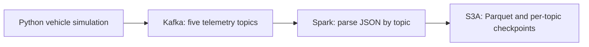

# Smart City Data Engineering

A streaming prototype that simulates a vehicle travelling from London to Birmingham. A Python producer sends five streams of synthetic telemetry to Kafka. A Spark job is configured to read those streams and write separate Parquet datasets to S3.

## Data flow

- [`jobs/main.py`](jobs/main.py) produces `vehicle_data`, `gps_data`, `traffic_data`, `weather_data` and `emergency_data` with a shared timestamp for each simulation tick.
- [`docker-compose.yml`](docker-compose.yml) defines ZooKeeper, a Confluent Kafka broker, a Spark master and two workers.
- [`jobs/spark-city.py`](jobs/spark-city.py) gives each topic its own schema and output path. It configures a two-minute event-time watermark and separate checkpoints.

## Reproduction status

This revision is useful for inspecting the producer and consumer, but a clean end-to-end run is not verified. The Spark Kafka connector coordinate in this revision is incomplete and its S3 destinations are hardcoded. Do not point this setup at a shared bucket or use it for production data. Checkpoints alone do not establish exactly-once delivery, and throughput and failure recovery have not been measured.
